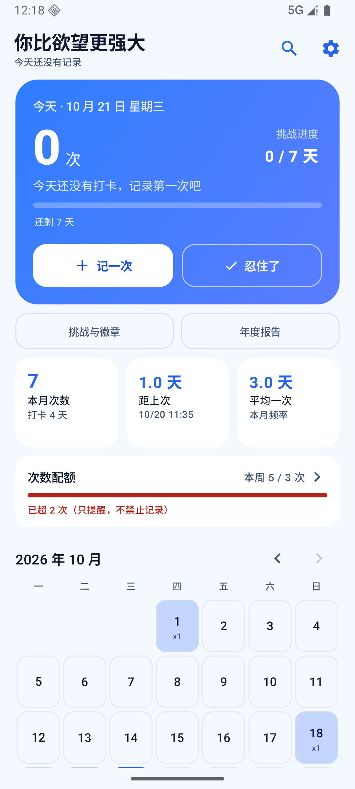
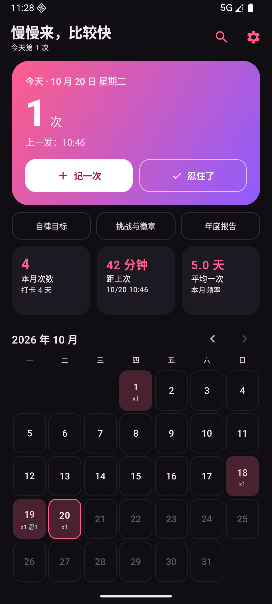
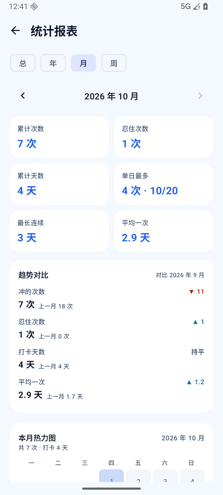
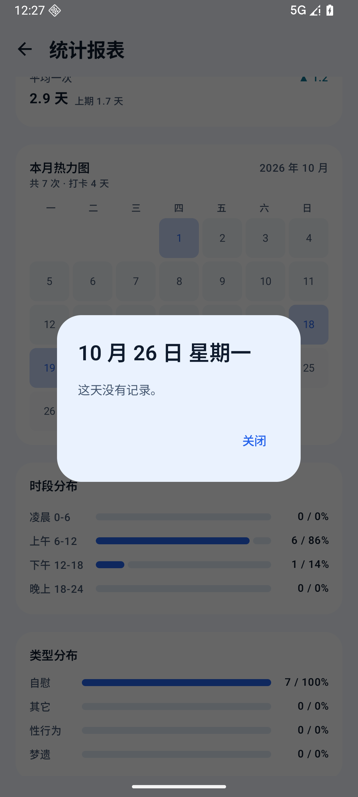
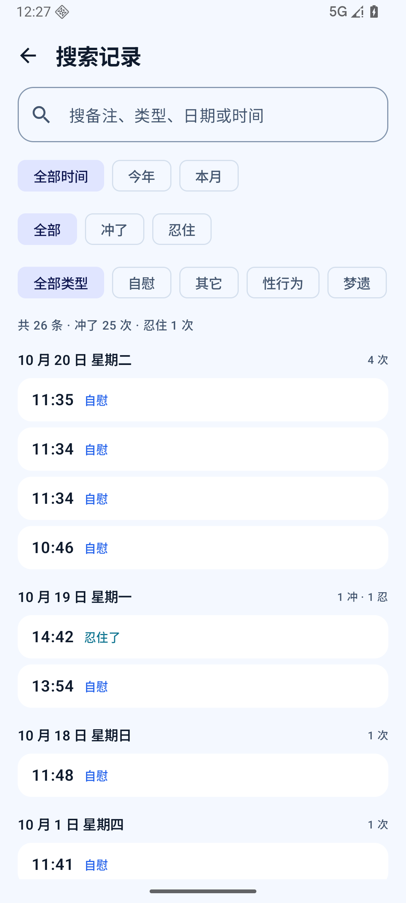
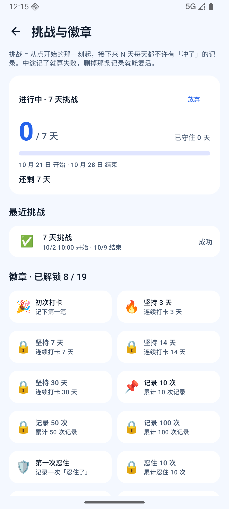
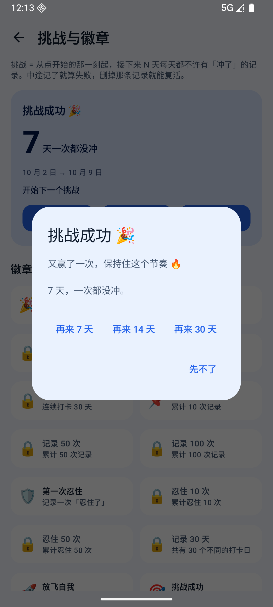
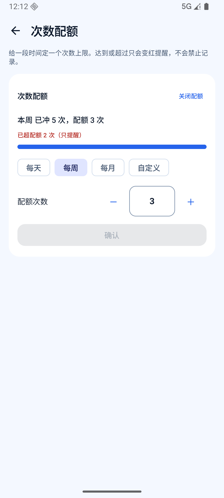
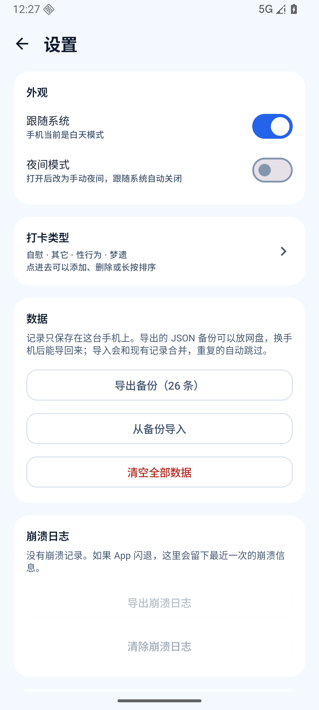
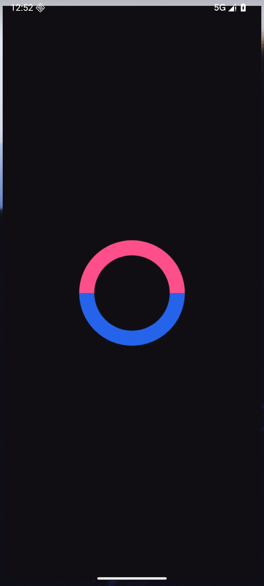

# 冲了吗 · Chonglema

> 记录每一次，了解自己。

一个**纯本地**的自律打卡 Android App：记录、统计、挑战与徽章、次数配额。Kotlin + Jetpack Compose 从零手写，不联网、不申请任何权限，数据只存在手机本机的 SQLite 里。

     

> 内容涉及成人话题，仅面向成年用户。本项目只做记录与统计，不构成任何医学或心理建议。

## 截图

| 首页（亮色） | 首页（夜间） | 统计报表 + 趋势对比 | 热力图点开某天 |
| --- | --- | --- | --- |
|  |  |  |  |

| 搜索与筛选 | 挑战进行中 | 挑战成功 | 次数配额 |
| --- | --- | --- | --- |
|  |  |  |  |

| 设置页 | 启动画面（夜间） |
| --- | --- |
|  |  |

图标换了 4 轮才定稿（深色底 + 粉蓝双色环），设计过程见 `docs/design/`。

## 功能

- **今日卡片**：今天几次、上一发时间、「记一次」打开记录面板（时间 / 类型 / 备注）、「忍住了」单独记一条不留次数；大卡右上角是**挑战进度**（未开始 / 进行中 X/N 天 / 最后一天 / 中断 / 成功），点它直接进挑战页；三张小卡下面的**次数配额**细卡显示「还剩 N 次 / 已超 N 次」
- **打卡日历**：按次数深浅着色，格子里显示 `xN` 与 `忍M`；点有记录的日期进入当天编辑（改时间/类型/备注、单条删除、清空当天），点过去空日期可补记，补记也能补「忍住了」
- **统计报表**：总 / 年 / 月 / 周四种周期，6 个核心指标 + 趋势对比（上一年 / 上一月 / 上一周）、年・月・周热力图（点任意格子看当天冲了/忍住几次）、时段分布、类型分布、柱状图
- **搜索与筛选**：关键词搜备注/类型/日期/时间，叠加「全部时间 / 今年 / 本月」「全部 / 冲了 / 忍住」「类型」三组筛选，结果按日期分组
- **次数配额**：每天 / 每周 / 每月 / 自定义起止，配额次数 1~999（可手输），改完点「确认」生效；保存后设置项自动收起，只显示进度，修改时先「关闭配额」再重设；超过配额只变红提醒、不禁止记录
- **挑战与徽章**：从点下「开始」的那一刻起，接下来 7 / 14 / 30 天每天都不许有「冲了」的记录；中途记了立刻中断，删掉那条记录就能复活。结果由记录实时计算（不单独存状态），保留挑战记录（最多 10 条，含成功 / 失败 / 已放弃，长按可删除）和 19 枚徽章
- **年度报告**：全年总览、每月叠柱、星期/时段/类型分布、自动生成的年度亮点、一键复制文字总结
- **外观**：白天蓝色系 / 夜间粉色系，默认跟随系统；夜间模式单独调过对比度
- **数据**：JSON 备份导出 / 导入（自动去重合并）、清空全部数据；崩溃日志可导出成 txt
- **自定义类型词条**：增删、长按拖动排序、恢复默认

## 下载

到 [Releases](https://github.com/IR141/chonglema/releases) 下载 `chonglema-v1.1-release.apk`，传到手机点击安装即可（约 1.7 MB）。

- 当前 release 用的是 **debug 签名**，好处是能直接覆盖安装、保留数据；如果你要自己发布，请换成自己的 keystore（见下）。
- 从旧版升级用 `adb install -r` 覆盖，数据库会自动迁移。这个版本是 **versionCode 46 / versionName 1.1**，可以直接覆盖之前的 4.x 内测版（versionCode 28）、1.0 公开版（versionCode 1）和 1.10.x 内测版（versionCode 45），数据保留。

## 从源码构建

### 环境

- **JDK 21**（AGP 9 要求最低 17，本项目用 21 验证）
- **Android SDK**：Platform 37、Build-Tools 37.0.0（`compileSdk / targetSdk = 37`，`minSdk = 26`）
- **Gradle**：仓库自带 wrapper（9.8.1），不需要自己装
- 无需 Android Studio，命令行即可构建

### 步骤

```bash
git clone https://github.com/IR141/chonglema.git
cd chonglema

# 指向本机 Android SDK（二选一）
export ANDROID_HOME="$HOME/Android/Sdk"
# 或新建 local.properties：sdk.dir=/path/to/Android/Sdk

# 编译 debug 包
./gradlew assembleDebug
# 产物：app/build/outputs/apk/debug/app-debug.apk

# 编译 release 包（当前配置为 debug 签名 + R8 压缩 + baseline profile）
./gradlew assembleRelease
```

Windows 用 `gradlew.bat`，并把 `ANDROID_HOME` 换成 `set ANDROID_HOME=D:\Android\Sdk`（或写进 `local.properties`）。

### 换自己的签名（发布用）

1. 生成 keystore：`keytool -genkeypair -v -keystore release.jks -alias chonglema -keyalg RSA -keysize 2048 -validity 10000`
2. 在项目根目录新建 `keystore.properties`（**已在 .gitignore 里，不要提交**）：
   ```properties
   storeFile=/absolute/path/to/release.jks
   storePassword=******
   keyAlias=chonglema
   keyPassword=******
   ```
3. 把 `app/build.gradle.kts` 里 release 的 `signingConfig = signingConfigs.getByName("debug")` 换成读取上面的配置。

### 工具链版本（踩过的坑）

- **AGP 9.4.1 内置 Kotlin 2.2.10**：不要再 `apply(plugin = "org.jetbrains.kotlin.android")`，否则会直接报错；`kotlinOptions {}` 也已迁移为 `kotlin.compilerOptions {}`。
- Compose 编译器插件版本必须和 AGP 内置 Kotlin 对齐：`org.jetbrains.kotlin.plugin.compose` 用 **2.2.10**。
- Compose BOM `2026.09.00`（Compose 1.12.x）要求 `compileSdk >= 37`。
- 数据层故意不用 Room/KSP（规避 AGP 9 内置 Kotlin 的 KSP 版本匹配问题），用 `SQLiteOpenHelper` 手写 DAO。

## 项目结构

```
app/src/main/
├── java/com/qingqian/chonglema/
│   ├── MainActivity.kt        单 Activity 入口：闪屏、主题、enableEdgeToEdge
│   ├── ChonglemaApp.kt        全局未捕获异常 → 本地崩溃日志
│   ├── data/                  SQLite（手写 DAO）、各 Store（StateFlow + SharedPreferences）、备份、崩溃日志
│   ├── stats/                 统计：记录聚合、报表周期、目标、挑战、徽章、年度报告
│   └── ui/                    Compose：Home / Search / Report / Settings / Quota / Challenge / Annual + 组件与主题
├── baseline-prof.txt          Baseline Profile（启动热路径，R8 后编进 assets/dexopt）
└── res/                       图标（自适应三层）、闪屏、主题色
```

架构要点：单 Activity + Compose `Crossfade` 七个屏幕；`MainViewModel` 收拢所有 Store 与动作（首帧后异步加载设置/词条/挑战）；没有网络库、没有分析 SDK、没有第三方图片库。

## 数据与隐私

- **不申请任何权限**（`AndroidManifest.xml` 里没有 `uses-permission`），没有 `INTERNET` 权限，代码里也没有任何网络请求
- 记录只写入本机 SQLite；`android:allowBackup="false"`，不会进系统云备份
- 导出备份/导入只经过系统文件选择器（SAF），文件落在你自己选的位置
- 卸载 App 即删除全部数据；详见 [PRIVACY.md](PRIVACY.md)

## 性能

做过的优化（详见 [CHANGELOG.md](CHANGELOG.md) 的 1.0）：R8 压缩 + `shrinkResources`（12.6 MB debug → 1.7 MB release）、Baseline Profile（模拟器同环境冷启动 736 ms → 587 ms）、热力图 Canvas 化（372 个 Compose 节点 → 12 个 Canvas）、写库改内存增量更新、SQLite WAL、启动延后加载。

## 已知限制

- 只适配竖屏手机，未做平板/横屏布局
- 界面文案只有中文
- 1.3 倍系统字体下，报表「时段分布」的标签和数值会折成两行
- 词条拖动排序的「拖动中」动画在无头模拟器里无法用 adb 截图验证，只有松手后的结果做过回归
- release 构建使用 debug 签名，**不适合直接上架应用商店**

## 更新记录

完整版本历史见 [CHANGELOG.md](CHANGELOG.md)。

## 贡献

欢迎 issue 和 PR，先看 [CONTRIBUTING.md](CONTRIBUTING.md)。提交前请确保 `./gradlew assembleDebug` 能通过。

## License

[Apache License 2.0](LICENSE)。第三方依赖各自遵循其原始许可证（AndroidX / Compose 为 Apache-2.0）。
